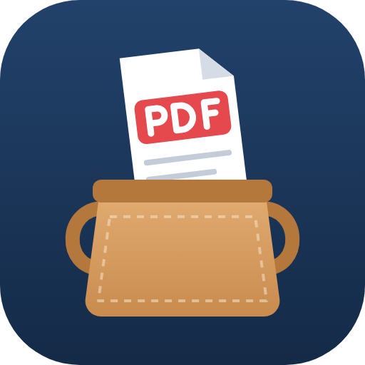

# LeSacAPDF



Application web installable (**PWA**) pour **Android et iPhone** : remplir, annoter et signer des PDF.
Version mobile de `EditeurPDF.html` : mêmes fonctions, interface pensée pour le doigt.
**Tout reste sur le téléphone** : aucun fichier n'est envoyé sur Internet, et l'application
fonctionne sans connexion une fois installée.

## Installer sur le téléphone

Adresse (après publication, voir plus bas) : `https://julienlesacapro-hub.github.io/LeSacAPDF/`

- **iPhone / iPad** : ouvrir l'adresse dans **Safari** → bouton **Partager** → **Sur l'écran d'accueil** → **Ajouter**.
- **Android** : ouvrir l'adresse dans **Chrome** → menu **⋮** → **Installer l'application**
  (ou le bandeau « Installer » proposé automatiquement). Une fois installée, elle apparaît
  dans le menu **Partager** des autres applications pour recevoir un PDF.
- **Ordinateur** (Chrome, Edge) : icône d'installation dans la barre d'adresse.

Les mises à jour sont automatiques : après une publication, la nouvelle version est
téléchargée en arrière-plan et s'affiche à l'ouverture suivante de l'application.

## Publier (GitHub Pages, gratuit pour ce dépôt public)

Le workflow `.github/workflows/pages.yml` publie le dossier `www/` à chaque envoi sur `main`.
Une seule fois : *Settings → Pages → Build and deployment → Source : **GitHub Actions***.

## Fonctions

| | |
|---|---|
| Formulaires PDF | les champs interactifs sont détectés et remplis directement (option « verrouiller les champs ») |
| Texte | police, taille, gras, italique, couleur ; deux appuis sur un texte pour le modifier |
| Signer | signature dessinée au doigt ou photo d'une signature (fond retiré automatiquement), mémorisée |
| Coche, croix, entourer, stylo, surligneur, masque blanc | outils de remplissage et d'annotation |
| Date, heure, image, textes enregistrés (en-tête, adresse, RPPS…) | insertion en un geste |
| Utilisateurs | plusieurs profils avec leurs signatures et textes ; sauvegarde / restauration (compatible avec la version ordinateur) |
| Enregistrer | qualité d'origine ou fichier allégé sous une taille maximale (Mo), puis **Partager** (mail, messagerie, « Enregistrer dans Fichiers ») |
| **Nouveau 3.1** — Imprimer | menu ⋮ → Imprimer : impression du document annoté via la fenêtre d'impression du téléphone |
| **3.1** — Organiser les pages | supprimer, réordonner (glisser ⠿), dupliquer, pivoter, avec aperçu en grand |
| **3.1** — Scinder | sélectionner des pages dans l'ordre voulu et en faire un nouveau PDF |
| **3.1** — Fusionner | assembler des pages de plusieurs PDF (lettres A, B, C… par document) |
| **3.1** — Scanner | photo → détection des bords, redressement, rendu Document / Couleur / Gris / Noir & blanc, contraste, plusieurs pages |
| **3.1** — Rechercher | texte surligné, insensible aux accents et majuscules |
| **3.1** — Tampons | « Lu et approuvé », « Bon pour accord », « Copie conforme »… datés automatiquement, tampons personnalisés |
| **3.1** — Documents récents | les 10 derniers PDF ouverts ou créés, rouvrables depuis l'accueil |
| **3.3** — Autres formats | Enregistrer / Partager en **image** (PNG ou JPEG, 96 à 300 ppp, une image par page, ZIP au téléchargement), **Word** (.docx), **OpenDocument** (.odt) ou **texte** (.txt) : texte extrait et modifiable, mise en page non conservée, option « image de chaque page » pour les PDF scannés |
| **4.0** — Filigrane | texte (préréglages PROJET, CONFIDENTIEL, « Usage exclusivement destiné à la location »…) ou image ; emplacement (diagonale, centre, haut, bas, mosaïque), transparence, police, gras, couleur, taille ou ajustement automatique |
| **4.0** — Mot de passe | chiffrement AES-256 (norme PDF 2.0, révision 6) à l'enregistrement d'un PDF |
| **4.0** — PDF/A, PowerPoint, Excel | PDF/A-2b (pages en images, profil sRGB intégré) ; PowerPoint .pptx (image fidèle ou texte modifiable) ; Excel .xlsx (une feuille par page, colonnes détectées, nombres en € et % reconnus) |
| **4.0** — Convertir en PDF | images (JPG, PNG, WebP…), Word .docx, OpenDocument .odt, PowerPoint .pptx, HTML, texte → un seul PDF (les documents mis en page deviennent des images) |
| **4.1** — Anciens formats Office | Word .doc et PowerPoint .ppt (97-2003) → PDF : texte et structure repris (paragraphes, tableaux, une page par diapositive avec titre et puces), sans les images ni la mise en forme d'origine |
| **4.0** — Censure définitive | rectangles noirs ou « censurer tous les résultats » d'une recherche ; les pages concernées sont rastérisées à l'enregistrement : le contenu caché est supprimé |
| **4.0** — Comparer | deux PDF côte à côte, lignes modifiées surlignées (A rouge / B vert), navigation de différence en différence, mode visuel (pixels) |
| Confort mobile | pincer pour zoomer, annuler/rétablir, aperçu des pages, mode sombre, hors connexion |

Bon à savoir : sur iPhone, les signatures et textes enregistrés de l'application installée sont
séparés de ceux de Safari. Utilisez *Menu → Sauvegarder / restaurer* pour les transférer.

## Développement

```bash
npm run serve                                         # http://localhost:8080
node tools/e2e-test.js fichier.pdf captures/ android   # test complet sur téléphone émulé (ou: iphone)
node tools/e2e-v31.js a.pdf b.pdf photo.jpg captures/ android   # test des fonctions 3.1
node tools/e2e-export.js a.pdf captures/                        # test des exports image / Word / ODT / texte
node tools/e2e-v4.js a.pdf b.pdf photo.jpg image.png page.html doc.docx doc.odt captures/ android   # test 4.0
npm run icons                                         # régénère les icônes depuis design/sac-source.jpg
```

À chaque nouvelle version, augmentez aussi `VERSION` dans `www/sw.js` : l'ancien cache
est alors purgé proprement.

## Dons (association PROMEDNAV)

L'écran d'accueil (sans document ouvert) et le menu affichent un appel aux dons pour l'association
PROMEDNAV. **Pour activer le bouton « Faire un don »**, renseignez le lien de la page de don dans
`www/js/app.js` :

```js
const DON_URL = "https://…";   // vide = « Le lien de don sera activé prochainement »
```

puis augmentez `VERSION` dans `www/sw.js` pour que les téléphones récupèrent la mise à jour.

## Propriété

© 2026 LESACA Julien — Tous droits réservés. Voir [LICENSE](LICENSE).

Bibliothèques incluses : [pdf.js 3.11.174](https://github.com/mozilla/pdf.js) (Apache 2.0,
variante *legacy* pour les iPhone plus anciens) et [pdf-lib 1.17.1](https://github.com/Hopding/pdf-lib)
(MIT), mêmes versions que dans `EditeurPDF.html` ; pour la conversion vers PDF :
[html2canvas 1.4.1](https://github.com/niklasvh/html2canvas) (MIT), [mammoth 1.13.0](https://github.com/mwilliamson/mammoth.js)
(BSD-2) et [cfb 1.2.2](https://github.com/SheetJS/js-cfb) (Apache 2.0, lecture des fichiers .doc et .ppt), chargés seulement quand on les utilise — licences dans `www/vendor/`. Le profil de couleur sRGB du PDF/A
est généré pour l'application à partir des valeurs publiques de la norme IEC 61966-2-1.
